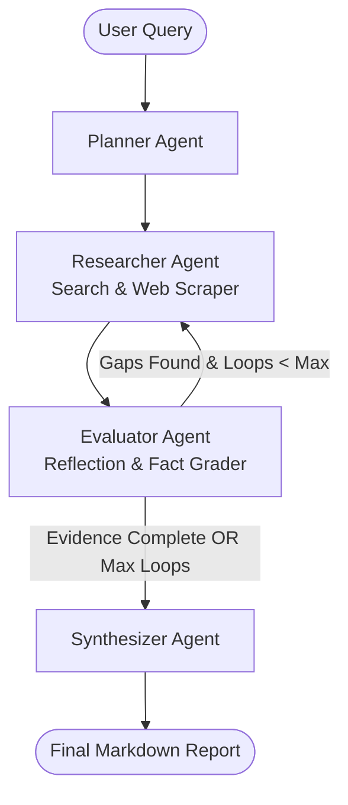

# DeepResearch: Autonomous Multi-Agent Research System

DeepResearch is an autonomous research system built with **LangChain (v0.3+)**, **LangGraph**, and **Google Gemini** (with multi-provider support for OpenAI, Claude, and local Ollama models). It takes any complex topic, deconstructs it into targeted search angles, crawls and scrapes web content, fact-checks evidence completeness with a self-reflection loop, and synthesizes publication-grade research reports with citations.

---

## Key Features

- **Multi-Agent Orchestration**: Powered by a cyclic LangGraph state machine coordinating Planner, Researcher, Evaluator, and Synthesizer agents.
- **Deep Web Grounding**: Live search and web scraping (DuckDuckGo Search out-of-the-box with 0 keys required, plus Tavily and Wikipedia fallbacks).
- **Self-Correction & Reflection Loop**: An Evaluator agent fact-checks gathered evidence against the original research plan. If blind spots or missing details are detected, it formulates targeted follow-up queries and triggers an iterative research cycle.
- **Authoritative Report Generation**: Produces comprehensive reports complete with executive summaries, technical deep dives, comparative analyses, and Markdown URL citations.
- **Dual Interfaces**:
  - **Modern Web Dashboard**: Clean, user-friendly Streamlit interface with real-time stage progression and one-click report exports.
  - **Command-Line Interface (CLI)**: Terminal runner with Rich formatting, live progress tracking, and automated file archiving.

---

## Architecture & Workflow

The system uses a cyclic StateGraph architecture:



### Agent Roles:
1. **Planner Agent** (`src/agents/planner.py`):
   - Deconstructs high-level topics into multi-dimensional sub-topics, working hypotheses, and targeted search queries.
2. **Researcher Agent** (`src/agents/researcher.py`):
   - Executes web searches, scrapes page content, strips boilerplate (ads/navs/scripts), and collects clean text.
   - Deduplicates sources by URL across iterative research rounds.
3. **Evaluator Agent** (`src/agents/evaluator.py`):
   - Audits gathered evidence against the original research plan.
   - Evaluates whether factual coverage is sufficient or if knowledge gaps remain (`is_sufficient: bool`).
   - Generates targeted follow-up queries when gaps are identified.
4. **Synthesizer Agent** (`src/agents/synthesizer.py`):
   - Compiles findings into an executive-ready Markdown report with inline citations and references.

---

## Quick Start

### 1. Prerequisites & Virtual Environment

Python 3.10+ is recommended. Create and activate a virtual environment:

```bash
python3 -m venv venv
source venv/bin/activate
pip install -r requirements.txt
```

### 2. Environment Configuration

Copy the example environment file:

```bash
cp .env.example .env
```

Configure your Google Gemini API key in `.env`:

```env
GOOGLE_API_KEY=your_actual_gemini_api_key_here
GEMINI_MODEL=gemini-3.5-flash-lite
```

*(Get a free Gemini API key at [Google AI Studio](https://aistudio.google.com/app/apikey)).*

> **Search Provider Note**: DuckDuckGo search is integrated out-of-the-box (no API key or registration required). If you have a [Tavily](https://tavily.com) key, you can optionally configure `TAVILY_API_KEY` in `.env` for advanced search fidelity.

---

## Running the Application

### Option A: Web Application (Streamlit)

Launch the interactive web application:

```bash
streamlit run app.py
```

Open `http://localhost:8501` in your browser to:
- Choose your research depth (Standard vs Deep Dive).
- Monitor live multi-agent execution steps.
- Inspect retrieved sources and web excerpts.
- Download formatted Markdown reports with one click.

### Option B: Command-Line Interface (CLI)

Run directly from the terminal with Rich progress indicators:

```bash
# Interactive prompt
python -m src.cli

# Or specify a topic directly
python -m src.cli "Electric vs Hybrid cars in 2025" --loops 2
```

Generated reports are automatically saved to the `reports/` directory.

---

## Project Structure

```
.
├── .env.example            # Environment variables template
├── .gitignore              # Git ignore rules (protects API keys and local data)
├── requirements.txt        # Pinned dependencies
├── README.md               # Documentation and architecture guide
├── app.py                  # Streamlit Web Application
├── reports/                # Output folder for generated Markdown reports
└── src/
    ├── __init__.py
    ├── config.py           # Configuration loader and settings
    ├── models.py           # Pydantic schemas and LangGraph state TypedDict
    ├── llm.py              # LLM factory (Gemini, OpenAI, Claude, Ollama)
    ├── graph.py            # LangGraph StateGraph assembly and cyclic routing
    ├── cli.py              # Terminal CLI runner
    ├── tools/
    │   ├── __init__.py
    │   ├── search.py       # Multi-provider search (DuckDuckGo, Tavily, Wikipedia)
    │   └── scraper.py      # Resilient HTML parser and text extractor
    └── agents/
        ├── __init__.py
        ├── planner.py      # Research strategy deconstruction
        ├── researcher.py   # Web search and scraping pipeline
        ├── evaluator.py    # Self-reflection and gap detection
        └── synthesizer.py  # Markdown report writer with citations
```

---

## Supported LLM Providers

| Provider | Recommended Model | API Key Required? |
| :--- | :--- | :--- |
| **Google Gemini** | `gemini-3.5-flash-lite`, `gemini-3.8-flash` | Yes (`GOOGLE_API_KEY`) |
| **OpenAI** | `gpt-4o-mini`, `gpt-4o` | Yes (`OPENAI_API_KEY`) |
| **Anthropic** | `claude-3-5-sonnet-20241022` | Yes (`ANTHROPIC_API_KEY`) |
| **Ollama** | `llama3`, `mistral` | No (Local instance) |

---

## License

MIT License.
